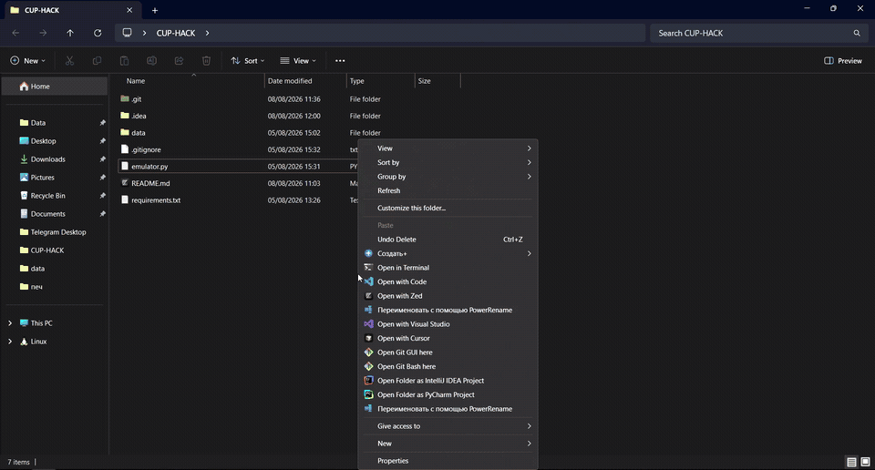

# Эмулятор телеметрии ЦУП

## Демонстрация



## Запуск с тестовыми данными

Нужен Python 3.10+. В этом режиме COM-порт и дополнительные библиотеки не
требуются.

1. Откройте терминал в папке со скриптом.
2. Запустите команду:

   ```powershell
   python emulator.py
   ```

3. Выберите номер файла с данными.

Скрипт запустит HTTP-адрес:

```text
http://127.0.0.1:8765/telemetry
```

Не закрывайте окно со скриптом, пока работает приложение. Чтобы остановить его,
нажмите `Ctrl+C`.

## Получение данных на Python

Функция делает один запрос и возвращает последнюю полученную строку телеметрии. Если
данные ещё не пришли, возвращает `None`.

```python
from urllib.request import urlopen

def get_latest_frame():
    with urlopen("http://127.0.0.1:8765/telemetry") as response:
        if response.status == 204:
            return None
        return response.read().decode("utf-8")


frame = get_latest_frame()
if frame is not None:
    print(frame)
```

Строка `frame` содержит один пакет телеметрии в исходном виде.

## Реальное устройство

Приложение делает запросы к тому же HTTP-адресу. Если данные поступают с
конструктора, запустите скрипт в режиме чтения COM-порта:

```powershell
python -m pip install -r requirements.txt
python emulator.py --source serial --port COM3 --baudrate 115200
```

Замените `COM3` на порт приёмника. Скрипт читает строки из COM-порта и
сохраняет последнюю.
Код получения данных при этом не меняется.

## Формат тестовых данных

```text
ПРЕАМБУЛА;ВРЕМЯ ОТ ЗАПУСКА МК;АКБ;СД1;СД2;СД3;СД4;AX;AY;AZ;GX;GY;GZ;MX;MY;MZ;МАХОВИК;ПОСТАМБУЛА
```

В штатных пакетах все числовые значения — целые. `АКБ` передаётся в
милливольтах; `СД1`-`СД4` находятся в диапазоне `0…65536`; AX/AY/AZ,
GX/GY/GZ, MX/MY/MZ и `МАХОВИК` `-32768…32767` .

Скрипт не зависит от этой структуры: он не разбирает значения, не считает поля
и передаёт каждую непустую строку как есть.

### Преобразование в физические единицы

| Поле | Формула | Физическая величина |
| --- | --- | --- |
| `АКБ` | `АКБ / 1000` | напряжение батареи, В |
| `СД1`–`СД4` | — | освещённость в условных единицах (`0…65535`) |
| `AX`, `AY`, `AZ` | `значение / 16384` | ускорение, g (диапазон ±2g) |
| `GX`, `GY`, `GZ` | `значение / 131.072` | угловая скорость, °/с (диапазон ±250 °/с) |
| `MX`, `MY`, `MZ` | `значение / 1711.6` | магнитное поле, Гс (диапазон ±16 Гс) |
| `МАХОВИК` | — | скорость вращения маховика; знак задаёт направление |

## Файлы телеметрии

Файлы находятся в `data`. Для `.csv` первая непустая строка по умолчанию
считается заголовком и не передаётся. 

- `01_normal_flight.csv` - 100 000 штатных пакетов с плавным изменением
  показателей датчиков.
- `02_sensor_faults.csv` - штатный участок, затем по очереди отключение
  каждого датчика, граничные, некорректные значения и хаотичные данные.
- `03_radio_noise.csv` - штатные измерения с редкими повреждениями
  преамбулы, постамбулы, значений и времени пакета.
