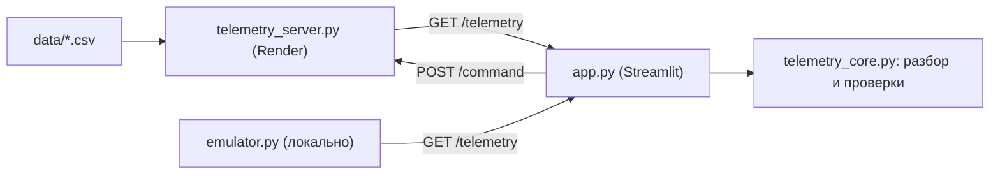

# 🛰️ ЦУП «ИнтроСат» — приложение центра управления полётами

Проект для онлайн-хакатона «Хакатон-ЦУП. Сезон 2026». Приложение принимает телеметрию учебного
спутника «ИнтроСат» (от эмулятора данных или реального устройства через него), проверяет каждый
пакет и показывает оператору состояние аппарата: статусы модулей, 3D-ориентацию, графики, события,
команды и лог.

**Онлайн-демо:** https://space-hackathon-mgutzzoq4haprzs57sde82.streamlit.app/
**Сервер телеметрии (Render):** https://space-telemetry-emulator.onrender.com/telemetry

> Бесплатные сервисы «засыпают» без запросов: первый ответ может занять около минуты.
> Если вверху красный баннер «Нет связи», подождите минуту — приложение переподключается само.

## Быстрый старт (без установки)

1. Откройте онлайн-демо (работает в браузере на любой ОС: Windows, Linux, macOS, телефон).
2. В боковой панели выберите **«Эмулятор (live)»** — данные идут с сервера на Render.
   Список **«Сценарий данных»** переключает файл: штатный полёт, сбои датчиков, радиошум.
3. Режим **«Файл (датасет)»** — просмотр файлов из `data/` по кадрам. Кнопки «◀ Пред. аномалия» и
   «След. аномалия ▶» сразу переходят к проблемным пакетам. Здесь же можно загрузить сохранённый лог.

## Запуск на своём компьютере (Windows / Linux / macOS)

Нужен Python 3.10+.

```bash
pip install -r requirements.txt
streamlit run app.py
```

**С официальным эмулятором** (`emulator.py` в репозитории):

```bash
python emulator.py --file 01_normal_flight.csv      # в отдельном терминале
```

В приложении выберите «Эмулятор (live)» и укажите адрес `http://127.0.0.1:8765/telemetry`.
Реальное устройство: `python emulator.py --source serial --port COM3` (адрес тот же).

## Возможности (по техническому заданию)

| Требование ТЗ | Реализация |
|---|---|
| Приём телеметрии в реальном времени | опрос `GET /telemetry` раз в секунду, значения в физических единицах |
| Данные и статусы модулей | цветные плитки: микроконтроллер, питание, датчик положения, датчики света, плата маховика, канал связи |
| Графики изменения параметров | АКБ (отдельный график напряжения), свет СД1–СД4, акселерометр, гироскоп, магнитометр, маховик |
| 3D-вид положения спутника | модель КА поворачивается по крену, тангажу и курсу (акселерометр + магнитометр) |
| Нештатные ситуации | нет связи с источником, прерванная передача, пустой ответ, повреждённые пакеты, отказ датчика, значения вне диапазона, «залипание» и скачки значений, ошибки времени |
| Индикация | зелёный — норма, жёлтый — внимание, красный (мигает) — авария; крупные шрифты, подсказки оператору |
| Команды | вкладка «Команды»: запрос статуса, остановка и запуск маховика, журнал команд |
| Сохранение телеметрии | вкладка «Лог»: сырой лог, разобранный отчёт, журнал команд (CSV) |
| Работа с сохранённой информацией | режим «Файл» → «Загрузить сохранённый лог»; вкладки «Статистика» и «События» |
| Дополнительно | общее состояние КА и рекомендации, статистика, сводка типов аномалий, таймлайн аномалий, уведомления об авариях |

## Результаты на тестовых файлах

| Файл | Что показывает приложение |
|---|---|
| `01_normal_flight.csv` | штатный полёт: аномалий нет |
| `02_sensor_faults.csv` | первые 10 000 пакетов в норме; далее отказ датчиков (поля без данных), значения вне диапазона, превышение магнитного поля, критичное напряжение АКБ, резкие скачки |
| `03_radio_noise.csv` | редкие повреждённые пакеты (около 1,5 %): преамбула, постамбула, нечисловые значения |

## Устройство проекта



| Файл | Назначение |
|---|---|
| `app.py` | веб-интерфейс на Streamlit: режимы live и файл, плитки, 3D, графики, статистика, события, команды, лог |
| `telemetry_core.py` | разбор пакетов и проверки: диапазоны, преамбула/постамбула, время, нули, залипание, скачки, отказ датчика |
| `telemetry_server.py` | облачный сервер телеметрии для Render: отдаёт кадры из `data/` и принимает команды |
| `emulator.py` | официальный эмулятор данных организаторов |
| `data/` | тестовые файлы `01_normal_flight.csv`, `02_sensor_faults.csv`, `03_radio_noise.csv` |
| `requirements.txt` | зависимости (`streamlit`, `pandas`, `plotly`) |

### Формат пакета

18 полей через `;`: `ПРЕАМБУЛА; ВРЕМЯ; АКБ; СД1–СД4; AX; AY; AZ; GX; GY; GZ; MX; MY; MZ; МАХОВИК; ПОСТАМБУЛА`.
Перевод в физические единицы: АКБ/1000 (В), ускорение /16384 (g), угловая скорость /131.072 (°/с),
магнитное поле /1711.6 (Гс). Маркеры преамбулы и постамбулы определяются автоматически: берётся самое
частое значение среди первых пакетов.

### Статусы пакетов

`NORMAL` — норма · `WARNING` — внимание · `FAULT` — авария · `CORRUPTED` — пакет повреждён и не разобран.

Шум и отказ датчика различаются: если поле пакета нечисловое 1–4 пакета подряд, это повреждение
(шум в канале связи), а если 5 пакетов подряд и больше — отказ датчика (красная плитка модуля,
остальные данные пакета продолжают показываться, у отказавшего датчика «н/д»).

Пороги напряжения АКБ **предварительные**: число ячеек батареи определяется по начальному напряжению
(8.4 В — две ячейки); на ячейку «внимание» вне 3.3–4.3 В, «авария» вне 3.0–4.5 В. Значения подобраны по
типичным характеристикам литиевых ячеек, официальных норм в документации организаторов нет. Остальные
пороги (число пакетов для «нулей» и «залипания», скачки) вынесены в начало `telemetry_core.py`.

## Облачный сервер телеметрии

`telemetry_server.py` запускается командой `python telemetry_server.py` (на Render порт берётся из
переменной `PORT`). Он работает как эмулятор организаторов: `GET /telemetry` возвращает последнюю
строку (или 204), параметр `?file=` выбирает файл из `data/`. Дополнительно принимает команды:
`POST /command` с телом `GET_STATUS`, `WHEEL_STOP` или `WHEEL_START`.

## Ограничения

- Официальный эмулятор работает только на передачу и команды не принимает. Команды реализованы на
  нашем сервере телеметрии; при подключении к официальному эмулятору приложение сообщает, что
  источник команды не принимает.
- В облаке данные отдаёт `telemetry_server.py` (тот же формат и адрес, что у эмулятора организаторов);
  локально приложение работает и с официальным `emulator.py`.
- Ориентация в 3D ориентировочная: оси датчиков считаются совпадающими с осями корпуса.
- Журналы приложения хранятся в памяти страницы — скачайте лог перед закрытием вкладки.

## Команда

Заполните: Nauyryz Inzhu/Amanzhol Aisha 10 grade
